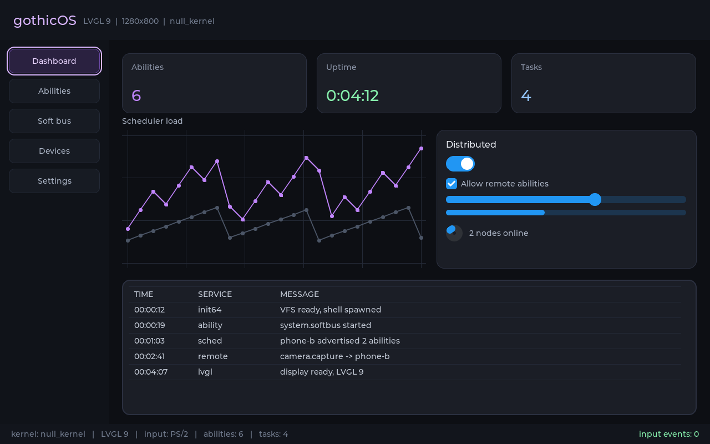

# LVGL on null_kernel

The graphical stack is **LVGL 9** rendering straight into a null_kernel linear
framebuffer. LVGL is the widget toolkit and drawing engine; InterfaceKit stays
the desktop/window server that owns surfaces and routes input. Nothing in LVGL
knows about Limine, ABI v3, `/dev/fb0` or syscalls.

## Where it lives

| Path | Role |
| --- | --- |
| `nullk/shared/lvgl_port/lv_conf.h` | Freestanding LVGL configuration |
| `nullk/shared/lvgl_port/lvgl_port.{c,h}` | Display flush, tick source, pointer and keypad devices |
| `nullk/tools/fetch_lvgl.sh` | Downloads the pinned LVGL release into `build/third_party` |
| `nullk/tools/lvgl_sim/` | Host simulator: renders a desktop through the port layer and writes a PNG |

LVGL's source is **not** committed. `fetch_lvgl.sh` pins version `9.2.2` and its
tarball SHA-256 and stages it under `build/third_party/lvgl-9.2.2` (already
ignored by `.gitignore`).

## Why not libnk

`libnk` is the freestanding syscall wrapper for **ABI v2**: `svc` stubs, fixed
64-byte IPC messages, fixed-block allocator, no display of any kind. Putting a
widget toolkit there would have:

- tied a 100 kB+ UI library to the Cortex-M3 microkernel image, where the whole
  board has 64 KiB of SRAM;
- put drawing policy inside the kernel-native library, which the
  hardware-abstraction rule says belongs above the seam;
- made the AMD64 port (ABI v3, a *different* syscall contract and a mapped
  framebuffer) a second, divergent copy.

Instead LVGL sits in `shared/`, next to `interfacekit_gfx.c`, and talks to an
`interfacekit_framebuffer_t` — a plain description of pixels, pitch and channel
masks. Any port can fill that in. That is the same seam InterfaceKit already
uses, so LVGL is a drop-in drawing engine rather than a new porting contract.

The three adapters a board has to supply:

1. **Display** — `lvgl_port_display_init(&fb, draw_buffer, bytes)`. The flush
   callback converts LVGL's XRGB8888 output into the framebuffer's masks and
   writes it with the framebuffer's pitch.
2. **Tick** — `lvgl_port_set_tick_cb(fn)`, returning monotonic milliseconds
   (`NK64_SC_TICKS` on AMD64, `CLOCK_MONOTONIC` on Linux, a counter in the sim).
3. **Input** — `lvgl_port_push_event()` with `lvgl_port_event_t` records; an
   AMD64 task converts `nk64_input_event_t` into those, a Linux port converts
   evdev events.

## Configuration choices

| Setting | Value | Reason |
| --- | --- | --- |
| `LV_COLOR_DEPTH` | 32 | XRGB8888, matching the Limine framebuffer and `/dev/fb0` |
| `LV_USE_STDLIB_MALLOC` / `_STRING` / `_SPRINTF` | `LV_STDLIB_BUILTIN` | No libc in the kernel: LVGL uses its own pool, `lv_strlen`, `lv_snprintf` |
| `LV_MEM_SIZE` | 256 KiB | Static pool in the task's `.bss`; measured against the dashboard below |
| `LV_USE_OS` | `LV_OS_NONE` | One task drives LVGL from its main loop |
| `LV_USE_FLOAT` | 0 | Avoids soft-float formatting in the kernel |
| `LV_USE_LOG` | 0 | Kernel log stays on the console |
| Fonts | Montserrat 14/16/24/28 | Proportional faces instead of the 3×5 InterfaceKit bitmap font |
| Widgets | defaults, no calendar/scale | Desktop shell does not need them |

Verified freestanding: all 311 LVGL source files compile with
`-ffreestanding -fno-builtin -nostdlib -m64 -Werror`.

## Host simulator

```sh
make -C nullk/tools/lvgl_sim -j        # build/third_party/lvgl_sim/dashboard.png
make -C nullk/tools/lvgl_sim check    # compile lvgl_port.c freestanding, -Werror
```

The simulator allocates a 1280×800 framebuffer, initialises the port exactly as
a task would, builds the gothicOS dashboard, pushes a pointer move, a click and
a key press, pumps twelve 33 ms frames and writes a PPM which `ppm2png.py`
converts. It prints how many input events the devices consumed, which is a
cheap check that the input path works.



## Status

### Bare-metal AMD64 (verified under QEMU)

`apps/lvgl64/` is a ring-3 task started with `ui lvgl`. It takes the single
framebuffer mapping (`NK64_SC_FB_INFO` + `NK64_SC_FB_MAP`), sets LVGL's tick from
`NK64_SC_TICKS` scaled by the kernel `tick_hz`, polls `NK64_SC_INPUT_READ` and
turns each record into a `lvgl_port_event_t`, then pumps LVGL in its loop.

Booted with Limine 12.11.1 + QEMU 8.2.2 (`-vga std`, 1280x800x32):

- serial log: `[lvgl64] framebuffer 1280x800 32bpp pitch=5120, tick=100Hz,
  LVGL 9.2.2 online`
- the dashboard paints (`docs/screenshots/lvgl-amd64-qemu.png`)
- 16 PS/2 events pushed, 16 consumed — every event reached an LVGL device
- a mouse click on the "Distributed" switch toggled it (1312 pixels changed in
  the switch area)
- five TAB presses moved the keyboard focus ring across the nav buttons
  (`docs/screenshots/lvgl-amd64-qemu-keyboard-focus.png`)

Kernel limits had to grow for this: `NK64_ELF_MAX` is now 1 MiB (the linked
userspace ELF is ~750 KiB) and the VFS pool is 4 MiB (the test initrd ships the
same ELF as init, shell and USB payload). The QEMU command needs
`-nodefaults` because this host's QEMU build lacks the e1000 option ROMs.

Known rough edge: the PS/2 decoder accumulates `mouse_move` deltas coarsely, so
scripted pointer aiming needs a feedback loop. Real mouse movement works; the
accumulated position just is not a 1:1 map of the requested deltas.

### Linux (builds, not boot-verified here)

The same `apps/lvgl64/main.c` compiles unchanged into the Linux port's
`nullk-linux.elf`, because the ABI v3 shim implements the three calls it uses:

| ABI call | Linux implementation |
| --- | --- |
| `NK64_SC_FB_INFO` / `FB_MAP` | `/dev/fb0` via `FBIOGET_VSCREENINFO`/`FSCREENINFO` + `mmap` |
| `NK64_SC_TICKS` | `clock_gettime` |
| `NK64_SC_INPUT_READ` | non-blocking `/dev/input/event*` (EV_REL, EV_KEY, shift state) |

`make -C nullk/ports/linux user` links LVGL into the hosted image. Booting it as
PID 1 was not possible in this environment (no framebuffer device, no Linux
image to boot), so the Linux path is compile-verified only.

### Not done yet

- No `lv_conf` profile for Cortex-M3/Pico; those boards have no display and no
  ABI v3 framebuffer.
- InterfaceKit still owns its own desktop; `ui lvgl` and `ui start` are mutually
  exclusive because only one task can claim the framebuffer per boot.
- No cursor is drawn by the shell yet; LVGL only moves focus and widgets.

## License

LVGL is MIT licensed (`build/third_party/lvgl-9.2.2/LICENCE.txt`, fetched with
the source). Shipping an image that links LVGL means including that notice.
